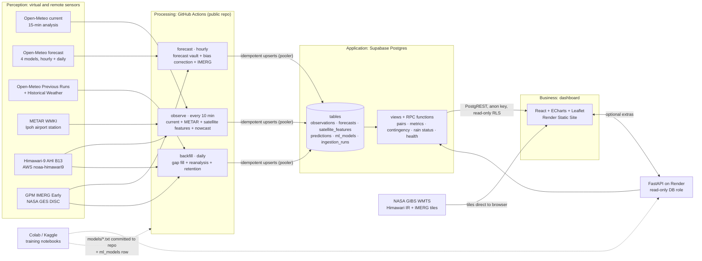
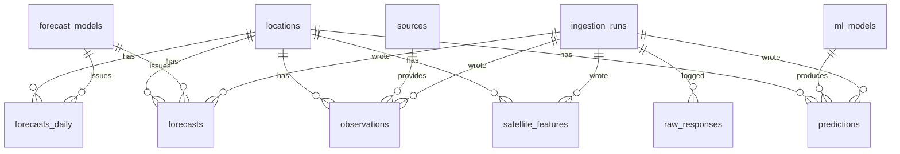

# Iskandar Weather Watch — Architecture

**v1.0 · RM0 free-tier stack · Solo build · Written 31 Oct 2026 from [plan.md](plan.md) and [suggestion.md](suggestion.md)**

> Companion docs: [api-spec.md](api-spec.md) (data contracts and endpoints) · [spec.md](spec.md) (dashboard UI) · [tasks.md](tasks.md) (build checklist).
> "Iskandar Weather Watch" (IWW) is a working name. Rename it freely.
> Facts marked ✔ were tested live on 30–31 Oct 2026. Items marked ⚠ still need checking during the build (see §15).

> **Scope change, 7 Nov 2026.** The deadline is Sun 8 Nov 2026, so the build is smaller than this document describes. [Implementation-plan.md](Implementation-plan.md) decides what gets built. In short:
> - Data is **retrieved retrospectively from Wed 4 Nov**, then collected live. The project uses no hardware, and every source keeps its own history. Retrieved rows stay marked (`is_backfill`, `origin = 'previous_runs'`).
> - The report's frozen window is 4–7 Nov, extended to 1–7 Nov only if a pre-set data check fails.
> - **Himawari, IMERG, the rain nowcast, FastAPI and the ML Lab are out of scope.** The rain lamp shows Open-Meteo's rain probability.
> - **One model is trained:** temperature bias correction (§9.2).
>
> The rest of this document stays as the full design.

---

## 1. Goals and non-goals

**Goals**

1. Collect weather for Seri Iskandar **continuously for 3+ days**, aiming for 7–14, with an uptime record that *proves* continuity.
2. Store **forecasts as issued** (the forecast vault) next to **actuals from several sources**, so accuracy can be measured by variable, lead time, model and hour of day.
3. Compute accuracy metrics **inside the database** (views and RPC functions), so the dashboard and the report read the same numbers.
4. Show it all on an **interactive dashboard** at a public URL, including a satellite-driven "about to rain" indicator.
5. Two ML models: a **satellite + weather rain nowcast** and **forecast bias correction**.
6. **RM0.** Every component runs on a free tier, with no card on file.

**Non-goals (for now):** an AI chat agent, a daily AI report, Telegram alerts, physical hardware, user accounts or login.

**Design rule:** every rubric-critical feature (ingestion, storage, accuracy, dashboard) must work **without FastAPI**. FastAPI sleeps on Render's free tier, so it serves only extras.

---

## 2. Stack (all free)

| Layer | Choice | Why |
|---|---|---|
| Scheduler + jobs | **GitHub Actions** cron on a **public** repo, Python 3.11 | Free, unlimited minutes on public repos, 5-min minimum interval |
| Database | **Supabase Postgres** (free: 500 MB, PostgREST Data API) | SQL views for the metrics, an instant REST API for the browser, RLS |
| DB driver (jobs) | `psycopg` 3 through the Supabase **session pooler** | ✔ GitHub runners have no IPv6, and Supabase's direct connection is IPv6-only, so jobs **must** use the pooler URL |
| Satellite processing | `satpy` (`ahi_hsd` reader), `numpy`, `bz2` | Standard reader for Himawari HSD files |
| ML training | Google Colab / Kaggle notebooks, `scikit-learn`, `lightgbm` | Free compute, and LightGBM gives small, fast, explainable models |
| ML inference | Inside the GitHub Actions jobs (`lightgbm`, `numpy`) | No always-on server needed |
| Frontend | React + Vite + TypeScript, Tailwind CSS, shadcn/ui, React Router, TanStack Query, `supabase-js` | The user's usual stack |
| Charts | **Apache ECharts** (tree-shaken `echarts/core`) | Zoom, brush, heatmaps, large data, theming |
| Maps | Leaflet + `react-leaflet`, CARTO/OSM dark and light base tiles, **NASA GIBS** WMTS overlays | Free, and GIBS serves Himawari IR tiles with no key |
| Frontend hosting | **Render Static Site** (free, never sleeps) | The user's chosen host |
| Extras API | **FastAPI** on a free **Render Web Service** (512 MB, sleeps after 15 min) | ML explanations, live ROC/AUC, onset analysis, CSV export |
| Secrets | GitHub Actions Secrets, Render env vars | Nothing secret in the repo |

---

## 3. System diagram



### 3.1 Mapping to the 5-layer IoT model (report §3)

| Layer | Component | Notes |
|---|---|---|
| Perception | Open-Meteo "virtual sensors", METAR WMKI (real instruments), Himawari-9 IR (remote-sensing sensor), IMERG (satellite rain) | The satellite is presented as a **remote-sensing sensor**, not as hardware |
| Transport | HTTPS REST **pull** from every source (none offer webhooks); HTTPS + TLS to Supabase; tiles pulled by the browser | Polling interval is justified by each source's update rate (§4) |
| Processing | GitHub Actions jobs: parse, convert units, extract features, run ML inference, upsert, log ("collect *and* process", Week 3 Method B) | Stateless and idempotent, so a job can be re-run safely |
| Application | Postgres tables, views and RPC functions; FastAPI extras | Analytics live next to the data |
| Business | Dashboard: accuracy, leaderboard, rain indicator, satellite loop, data health | The rain indicator is the virtual "actuator" |

### 3.2 Data flow in one sentence per path (report "Data Flow Description")

1. **Observation path:** every 10 min, `observe` pulls Open-Meteo `current` and METAR, upserts them into `observations`, downloads the newest Himawari band 13 segment, crops 10/25/50 km circles around Seri Iskandar into `satellite_features`, then runs the nowcast and writes `predictions`.
2. **Forecast path:** every hour, `forecast` stores the full 7-day hourly and daily forecast for each model run it has not stored yet in `forecasts` / `forecasts_daily`, writes bias-corrected values to `predictions`, and pulls recent IMERG rain into `observations`.
3. **Repair path:** once a day, `backfill` refills missed 15-min samples and satellite slots, adds the reanalysis "actual", rebuilds missed forecasts from the Previous Runs API, and trims old raw payloads.
4. **Read path:** the browser calls Supabase views and RPC functions with the public anon key (read-only by RLS) and loads satellite tiles straight from NASA GIBS. It calls FastAPI only for the ML Lab extras and CSV export.

---

## 4. Data sources and sampling

| Source code | Endpoint | Cadence / latency | Poll | Gives | Role |
|---|---|---|---|---|---|
| `openmeteo_current` | `api.open-meteo.com/v1/forecast?current=…` | ✔ `interval: 900` (15 min); precipitation is the **15-min sum** | every 10 min | temp, RH, dew point, precip, wind, MSL pressure, cloud, weather code | **Primary actual** (the brief's "observed") |
| (gap fill of the above) | same endpoint, `minutely_15=…&past_days=2` | ✔ past 15-min values available | daily | same 15-min values | Refills samples missed by late cron runs |
| `openmeteo_reanalysis` | `archive-api.open-meteo.com/v1/archive` | hourly, ~1–2 day delay | daily | hourly reanalysis | Second actual + ML history |
| `metar_wmki` | `aviationweather.gov/api/data/metar?ids=WMKI&format=json&hours=3` | ✔ hourly at :00, received ~8 min later | every 10 min | temp, dew point, wind (kt), QNH, `wxString` (RA/TS) | **Real instrument** truth, 26 km NE |
| `imerg_early` | NASA GES DISC (Earthdata login) | half-hourly, ~4–6 h latency | hourly + daily | 0.1° rain rate | Satellite rain truth + nowcast labels |
| Forecast vault | `api.open-meteo.com/v1/forecast?models=…&hourly=…&daily=…` | ECMWF/GFS/ICON update every 6 h (✔ `meta.json`); `best_match` blends hourly | hourly | 7-day hourly + daily | The forecasts being verified |
| Model run times | `api.open-meteo.com/data/{meta_key}/static/meta.json` | ✔ `last_run_initialisation_time`, `last_run_availability_time` | hourly | run timestamps | Store each model run **once** (§6.2) |
| Previous Runs | `previous-runs-api.open-meteo.com/v1/forecast` | ✔ data from about **Mar 2024** (Jan 2024 is null) | daily + training | `*_previous_day1..7` | Gap repair + bias-correction training |
| Himawari-9 B13 | `https://noaa-himawari9.s3.amazonaws.com/AHI-L1b-FLDK/YYYY/MM/DD/HHMM/HS_H09_YYYYMMDD_HHMM_B13_FLDK_R20_S0510.DAT.bz2` | ✔ every 10 min, on AWS ~10–20 min after scan start | every 10 min | 2 km IR brightness temperature | ML features |
| GIBS tiles | `https://gibs.earthdata.nasa.gov/wmts/epsg3857/best/{Layer}/default/{Time}/GoogleMapsCompatible_Level6/{z}/{y}/{x}.png` | ✔ Himawari layer ~50 min behind real time; IMERG ~6 h | browser | PNG tiles, max native zoom **6** | Dashboard imagery only |

**Fixed location:** Seri Iskandar, **4.35993 N, 100.98491 E**, 25 m. ✔ Open-Meteo snaps it to the grid cell at 4.3937 N, 100.9738 E (elevation 21 m).

**Why poll `current` every 10 min when it updates every 15:** the satellite needs a 10-min cadence anyway. Polling at minutes 7, 17, 27, … sees every 15-min value at least once. Duplicates are absorbed by the unique key, and missed values are refilled daily.

**Attribution (required):** "Weather data by Open-Meteo.com (CC BY 4.0)", plus NOAA/JMA Himawari, NASA GIBS, NASA GPM IMERG and NOAA AWC METAR. Shown in the dashboard footer and cited in the report.

---

## 5. Time and measurement conventions

These rules prevent most off-by-one-hour bugs. Every module follows them.

| Rule | Detail |
|---|---|
| Storage time zone | **UTC everywhere** (`timestamptz`). Request Open-Meteo hourly data with `timezone=GMT`. Display in **Asia/Kuala_Lumpur (MYT, UTC+8)** |
| Daily aggregation | Daily forecasts are requested with `timezone=Asia/Kuala_Lumpur`, so daily max/min follow **local** days. `target_date` is a local date |
| Interval-end stamping | For accumulated quantities, `observed_at` is the **end** of the interval: a 15-min sample at 12:15 covers 12:00–12:15, and an IMERG half-hour 12:00–12:30 is stored at 12:30 |
| Hourly bucket | Hour `H` aggregates samples in **(H−1h, H]**, matching Open-Meteo's hourly precipitation ("sum of the preceding hour") |
| Instantaneous variables | Temperature, RH, wind and pressure at hour `H` use the sample stamped exactly `H`, or the mean of the bucket if that sample is missing |
| Pressure | Compare **MSL pressure** everywhere (`pressure_msl`, METAR QNH). Never mix it with surface pressure |
| Units | °C, %, mm, km/h (METAR knots × 1.852), hPa, K for brightness temperature |
| Rain hour | Hourly precipitation **≥ 0.1 mm**, or the station reports RA/DZ/SH/TS precipitation |
| Rain day | Daily total **≥ 1.0 mm** |
| `issued_at` | When **we first obtained** that forecast (fetch time truncated to the hour). This is the lead time a Seri Iskandar resident would have experienced |
| `model_run_at` | The model's initialisation time from `meta.json`, when known (null for `best_match`) |
| Lead time | `lead_hours = target_time − issued_at`, in whole hours, stored as a generated column |
| Lead buckets | `000-006`, `006-012`, `012-024`, `024-048`, `048-072`, `072-120`, `120-168` (zero-padded so they sort as text) |

---

## 6. Scheduled jobs

All three jobs are Python modules in `ingest/iww_ingest/jobs/`, run as `python -m iww_ingest.jobs.<job>`. Each one:

1. inserts an `ingestion_runs` row (`status='running'`),
2. runs its steps **independently**, so one failing source doesn't stop the others, recording per-step status and timing in `steps`,
3. upserts with `ON CONFLICT` on natural keys (**idempotent**: re-running never duplicates rows),
4. finishes the run as `success`, `partial` (some steps failed) or `failed`, with `rows_written` per table.

HTTP calls use a shared client: 15 s timeout and 3 retries with exponential backoff (1, 3 and 9 s) on 5xx and timeouts, but not on 4xx. Calls go out with a descriptive `User-Agent` (`iww-ingest/1.0 (student project; contact email)`).

### 6.1 `observe` — every 10 min (`7-59/10 * * * *`)

Minutes 7, 17, 27, … avoid GitHub's crowded top-of-hour slot, and Himawari slot HH:M0 is usually on AWS by then.

| Step | Action | Writes |
|---|---|---|
| 1 `om_current` | GET `current=temperature_2m,relative_humidity_2m,dew_point_2m,precipitation,rain,weather_code,wind_speed_10m,wind_direction_10m,pressure_msl,cloud_cover` with `timezone=GMT`. `observed_at = current.time`, `interval_min = 15` | `observations` (1 row) |
| 2 `metar` | GET the last 3 h for WMKI. Per report: `observed_at = obsTime`, wind kt → km/h, RH from temp/dew point (Magnus), `is_raining = wxString ~ (RA\|DZ\|SH)`, `is_thunder = wxString ~ TS` | `observations` (0–3 rows) |
| 3 `himawari` | List `AHI-L1b-FLDK/…/` prefixes for the last 2 h. For every slot **newer than the last stored `slot_time`** (oldest first, max 12 per run): download `…B13_FLDK_R20_S0510.DAT.bz2` (~2.9 MB), decompress, load with satpy, crop with cached masks (§8.1), compute features, upsert | `satellite_features` (3 rows per slot) |
| 4 `nowcast` | Build the feature vector for the newest slot (§9.1), score with the active `rain_nowcast` model (or the `rule_235k` fallback), add the top-5 feature contributions | `predictions` (2 rows: `rain_1h_prob`, `rain_3h_prob`) |

Catch-up: if GitHub skipped runs, step 3 processes up to 12 missed slots in one go. Older gaps are left to `backfill`, which is real **store-and-forward**.

### 6.2 `forecast` — hourly (`17 * * * *`)

| Step | Action | Writes |
|---|---|---|
| 1 `model_runs` | For each model with a `meta_key`, GET `meta.json`. A model is **due** if `last_run_initialisation_time` is newer than the latest `model_run_at` stored for it. `best_match` is always due | — |
| 2 `vault` | One GET for all due models: `models=<due>&hourly=temperature_2m,relative_humidity_2m,dew_point_2m,precipitation,precipitation_probability,wind_speed_10m,wind_direction_10m,pressure_msl,cloud_cover,cape,weather_code&daily=temperature_2m_max,temperature_2m_min,precipitation_sum,precipitation_probability_max,precipitation_hours,wind_speed_10m_max&forecast_days=7&timezone=Asia/Kuala_Lumpur`. Convert hourly times to UTC with `utc_offset_seconds`. Keep only `target_time ≥ issued_at`. Unpack the `<var>_<model>` keys ✔ | `forecasts` (~168 rows per model), `forecasts_daily` (~7 per model), `raw_responses` (1) |
| 3 `bias` | For the `best_match` snapshot just stored, apply each active `bias_*` model to leads 0–72 h | `predictions` (73 × 3 rows) |
| 4 `imerg` | Fetch IMERG Early half-hours for the window now−8 h to now−4 h that aren't stored yet (§6.4) | `observations` (`imerg_early`) |

Storing each 6-hourly model run **once**, instead of hourly copies of the same run, cuts storage about 6× for ECMWF/GFS/ICON. It also stops the same forecast being counted six times in `n`. ⚠ If a `meta.json` mapping fails, the job falls back to storing that model every hour and logs a warning.

### 6.3 `backfill` — daily (`40 19 * * *` = 03:40 MYT)

| Step | Action | Writes |
|---|---|---|
| 1 `om_gapfill` | `minutely_15=…&past_days=2`. Insert only **missing** 15-min samples (`ON CONFLICT DO NOTHING`, `is_backfill = true`) | `observations` |
| 2 `reanalysis` | Historical Weather API for the last 5 days (hourly) | `observations` (`openmeteo_reanalysis`) |
| 3 `imerg_catchup` | IMERG Early for the last 48 h, any missing half-hours | `observations` |
| 4 `himawari_gaps` | Find missing 10-min slots in the last 48 h and re-download them from the AWS archive. Recompute `d_bt_*` for neighbouring slots | `satellite_features` |
| 5 `previous_runs` | For `target_time` hours in the last 7 days where a model has **no** snapshot at a given day-lead, insert `origin='previous_runs'` rows from `*_previous_dayN` (`issued_at = target_time − N days`, approximate) | `forecasts` |
| 6 `retention` | Delete `raw_responses` older than 30 days; `VACUUM (ANALYZE)` the hot tables | — |

### 6.4 IMERG access

Use the free NASA Earthdata login (`EARTHDATA_USERNAME` / `EARTHDATA_PASSWORD` secrets) with the `earthaccess` library. Open each half-hourly IMERG Early V07 granule (`GPM_3IMERGHHE`) through OPeNDAP and read only the 0.1° cells within 10 km of Seri Iskandar. Store the mean rate (mm/h), `precipitation_mm = rate × 0.5`, and `is_raining = max rate ≥ 0.5 mm/h`. ⚠ Confirm the collection short name and OPeNDAP subsetting during setup. Fallback: download the full HDF5 granule (~several MB) and slice it locally.

### 6.5 Workflow template

```yaml
# .github/workflows/observe.yml
name: observe
on:
  schedule: [{ cron: "7-59/10 * * * *" }]
  workflow_dispatch: {}
concurrency: { group: observe, cancel-in-progress: false }   # never overlap two runs
jobs:
  run:
    runs-on: ubuntu-latest
    timeout-minutes: 8
    steps:
      - uses: actions/checkout@v4
      - uses: actions/setup-python@v5
        with: { python-version: "3.11", cache: pip, cache-dependency-path: ingest/requirements.txt }
      - uses: actions/cache@v4            # cached crop masks (§8.1)
        with: { path: ingest/.cache, key: masks-v1 }
      - run: pip install -r ingest/requirements.txt && pip install -e ingest
      - run: python -m iww_ingest.jobs.observe
        env:
          SUPABASE_DB_URL: ${{ secrets.SUPABASE_DB_URL }}   # session pooler URI
          GH_RUN_ID: ${{ github.run_id }}
          CONTACT_EMAIL: ${{ secrets.CONTACT_EMAIL }}
```

`forecast.yml` and `backfill.yml` follow the same pattern with their own cron, `timeout-minutes` (10 and 20) and the `EARTHDATA_*` secrets. A `ci.yml` runs `pytest` and `npm run build` on every push.

**GitHub cron caveats:** runs can start 5–30 min late under load, and scheduled workflows are disabled after 60 days without a commit, which is not a risk inside this project's timeline. The data-health page measures the real start delay (§11).

---

## 7. Database schema (Supabase Postgres)

Migration files live in `supabase/migrations/`, applied in order with the Supabase SQL editor or `supabase db push`.

### 7.1 Reference tables

```sql
-- 0001_core.sql
create table locations (
  id          smallint primary key,
  name        text not null,
  lat         double precision not null,
  lon         double precision not null,
  grid_lat    double precision,               -- Open-Meteo grid cell actually used
  grid_lon    double precision,
  elevation_m real,
  tz          text not null default 'Asia/Kuala_Lumpur'
);

create table sources (                          -- every "actual" source, described once
  code        text primary key,                 -- openmeteo_current | openmeteo_reanalysis | metar_wmki | imerg_early
  kind        text not null check (kind in ('model_analysis','reanalysis','station','satellite')),
  name        text not null,
  lat         double precision,
  lon         double precision,
  distance_km real,                             -- from Seri Iskandar
  cadence_min smallint not null,
  notes       text
);

create table forecast_models (
  code        text primary key,                 -- the Open-Meteo `models=` value
  name        text not null,
  provider    text not null,
  meta_key    text,                             -- meta.json key; null = no single run (best_match)
  update_h    smallint,                         -- nominal update interval
  is_active   boolean not null default true
);
```

### 7.2 Run log and raw payloads

```sql
create table ingestion_runs (                   -- proof of continuous operation
  id           bigserial primary key,
  job          text not null check (job in ('observe','forecast','backfill','manual')),
  trigger      text not null default 'schedule' check (trigger in ('schedule','dispatch','local')),
  gh_run_id    bigint,
  started_at   timestamptz not null default now(),
  finished_at  timestamptz,
  status       text not null default 'running'
               check (status in ('running','success','partial','failed')),
  rows_written jsonb not null default '{}'::jsonb,   -- {"observations":2,"satellite_features":3}
  steps        jsonb not null default '[]'::jsonb,   -- [{"step":"metar","ok":true,"ms":412,"error":null}]
  error        text
);
create index on ingestion_runs (job, started_at desc);

create table raw_responses (                    -- reprocessing safety net, 30-day retention
  id          bigserial primary key,
  run_id      bigint references ingestion_runs on delete cascade,
  source      text not null,
  url         text not null,                    -- with no secrets in it
  http_status smallint,
  fetched_at  timestamptz not null default now(),
  payload     jsonb
);
create index on raw_responses (fetched_at);
```

### 7.3 Observations (the "actual" weather, many sources)

```sql
create table observations (
  id               bigserial primary key,
  location_id      smallint not null references locations,
  source           text not null references sources(code),
  observed_at      timestamptz not null,        -- UTC, END of the interval (§5)
  interval_min     smallint,                    -- 15 current · 60 reanalysis · 30 imerg · null metar
  temperature_c    real,
  dew_point_c      real,
  humidity_pct     real,
  precipitation_mm real,                        -- accumulated over interval_min
  rain_rate_mmh    real,                        -- imerg only
  wind_speed_kmh   real,
  wind_dir_deg     real,
  pressure_hpa     real,                        -- MSL / QNH
  cloud_cover_pct  real,
  weather_code     smallint,                    -- WMO code (Open-Meteo)
  is_raining       boolean,                     -- station/satellite flag; null for model sources
  is_thunder       boolean,
  is_backfill      boolean not null default false,
  raw              jsonb,                       -- the source record as received
  run_id           bigint references ingestion_runs,
  inserted_at      timestamptz not null default now(),
  unique (location_id, source, observed_at)
);
create index on observations (source, observed_at desc);
```

### 7.4 Forecast vault

```sql
create table forecasts (                        -- hourly, one row per (model run, target hour)
  id                     bigserial primary key,
  location_id            smallint not null references locations,
  model                  text not null references forecast_models(code),
  origin                 text not null default 'snapshot' check (origin in ('snapshot','previous_runs')),
  issued_at              timestamptz not null,  -- when we obtained it (hour)
  model_run_at           timestamptz,           -- model initialisation time, if known
  target_time            timestamptz not null,  -- hour being predicted (instant vars at H, precip over (H-1h,H])
  lead_hours             smallint generated always as
                           ((extract(epoch from (target_time - issued_at)) / 3600)::smallint) stored,
  temperature_c          real,
  humidity_pct           real,
  dew_point_c            real,
  precipitation_mm       real,
  precip_probability_pct real,
  wind_speed_kmh         real,
  wind_dir_deg           real,
  pressure_hpa           real,                  -- MSL
  cloud_cover_pct        real,
  cape_jkg               real,
  weather_code           smallint,
  run_id                 bigint references ingestion_runs,
  unique (location_id, model, origin, issued_at, target_time)
);
create index on forecasts (location_id, target_time);
create index on forecasts (model, lead_hours);

create table forecasts_daily (                  -- next-day max/min and rain total (brief requirement)
  id                         bigserial primary key,
  location_id                smallint not null references locations,
  model                      text not null references forecast_models(code),
  issued_at                  timestamptz not null,
  target_date                date not null,     -- local MYT date
  lead_days                  smallint not null, -- target_date - local date of issued_at
  temp_max_c                 real,
  temp_min_c                 real,
  precipitation_sum_mm       real,
  precip_probability_max_pct real,
  precipitation_hours        real,
  wind_speed_max_kmh         real,
  run_id                     bigint references ingestion_runs,
  unique (location_id, model, issued_at, target_date)
);
```

### 7.5 Satellite features

```sql
create table satellite_features (
  id                 bigserial primary key,
  location_id        smallint not null references locations,
  slot_time          timestamptz not null,      -- Himawari scan start, 10-min slot (UTC)
  radius_km          smallint not null check (radius_km in (10, 25, 50)),
  pixel_count        int not null,
  bt_min_k           real,                      -- coldest cloud top
  bt_mean_k          real,
  bt_p10_k           real,                      -- 10th percentile (robust "coldest")
  frac_lt_235        real,                      -- share of pixels < 235 K (rain cloud)
  frac_lt_221        real,                      -- share < 221 K (deep convection)
  d_bt_mean_10m      real,                      -- change vs 10/30/60 min earlier (K); negative = cooling
  d_bt_mean_30m      real,
  d_bt_mean_60m      real,
  d_bt_p10_30m       real,
  upwind_frac_lt_235 real,                      -- 25–75 km upwind sector (50 km row only)
  source_file        text,
  run_id             bigint references ingestion_runs,
  unique (location_id, slot_time, radius_km)
);
create index on satellite_features (slot_time desc);
```

### 7.6 ML registry and predictions

```sql
create table ml_models (
  id             serial primary key,
  name           text not null,                 -- rain_nowcast | bias_temperature | bias_humidity | bias_wind
  version        text not null,                 -- v0-rule, v1.0, v1.1 …
  algorithm      text not null check (algorithm in ('rule','logreg','lightgbm','cnn')),
  features       text[] not null,
  train_window   tstzrange,
  test_window    tstzrange,
  metrics        jsonb not null default '{}'::jsonb,  -- offline test metrics + baselines + thresholds
  importance     jsonb,                               -- [{"feature":"frac_lt_235_r25","gain":0.31}, …]
  artifact_path  text,                                -- models/rain_nowcast/v1.0/model.txt
  artifact_sha256 text,
  is_active      boolean not null default false,
  trained_at     timestamptz not null default now(),
  unique (name, version)
);
create unique index ml_models_one_active on ml_models (name) where is_active;

create table predictions (
  id          bigserial primary key,
  location_id smallint not null references locations,
  model_id    int not null references ml_models,
  issued_at   timestamptz not null,             -- nowcast: satellite slot time · bias: forecast issued_at
  target_time timestamptz not null,             -- nowcast: window END · bias: forecast hour
  variable    text not null,                    -- rain_1h_prob | rain_3h_prob | temperature_c | humidity_pct | wind_speed_kmh
  value       real not null,
  base_model  text,                             -- bias: the raw model corrected (best_match)
  base_value  real,                             -- bias: the raw forecast value
  lead_hours  smallint,
  explain     jsonb,                            -- nowcast: top-5 contributions [{"feature","value","contrib"}]
  run_id      bigint references ingestion_runs,
  unique (location_id, model_id, variable, issued_at, target_time)
);
create index on predictions (variable, issued_at desc);
```

### 7.7 Seed data

```sql
-- 0005_seed.sql
insert into locations values
  (1, 'Seri Iskandar', 4.35993, 100.98491, 4.3937, 100.9738, 25, 'Asia/Kuala_Lumpur');

insert into sources values
  ('openmeteo_current',    'model_analysis', 'Open-Meteo current (15-min)',        4.3937, 100.9738, 4,  15, 'Primary actual. Model-based, not a gauge'),
  ('openmeteo_reanalysis', 'reanalysis',     'Open-Meteo Historical Weather',      4.3937, 100.9738, 4,  60, 'Retrospective best estimate, 1–2 day delay'),
  ('metar_wmki',           'station',        'METAR WMKI Ipoh Sultan Azlan Shah',  4.568,  101.092,  26, 60, 'Real instruments; rain yes/no only'),
  ('imerg_early',          'satellite',      'GPM IMERG Early V07 (0.1°)',          4.35,   100.95,   4,  30, 'Satellite rain estimate, ~4–6 h latency');

insert into forecast_models values
  ('best_match',    'Open-Meteo Best Match', 'Open-Meteo', null,          1, true),
  ('ecmwf_ifs025',  'ECMWF IFS 0.25°',       'ECMWF',      'ecmwf_ifs025', 6, true),
  ('gfs_seamless',  'NOAA GFS',              'NOAA',       'ncep_gfs025',  6, true),
  ('icon_seamless', 'DWD ICON',              'DWD',        'dwd_icon',     6, true),
  -- optional bonus: an AI weather model and the regional JMA model (✔ both return data)
  ('ecmwf_aifs025_single', 'ECMWF AIFS (AI model)', 'ECMWF', 'ecmwf_aifs025_single', 6, false),
  ('jma_seamless',  'JMA GSM',               'JMA',        'jma_gsm',      6, false);

insert into ml_models (name, version, algorithm, features, metrics, is_active) values
  ('rain_nowcast', 'v0-rule', 'rule', array['frac_lt_235_r25','d_bt_mean_30m_r25'],
   '{"thresholds":{"watch":0.3,"likely":0.6}}', true);   -- works from day 1, before ML training
```

`gfs_seamless` and `icon_seamless` are "seamless" blends. Over Malaysia only the global members apply, so their run time follows `ncep_gfs025` and `dwd_icon` (⚠ confirm the run times line up).

### 7.8 Entity relationships (for the report's ER diagram)



### 7.9 Security (RLS)

```sql
-- 0004_rls.sql: weather data is public, writes come only from jobs
do $$ declare t text; begin
  foreach t in array array['locations','sources','forecast_models','ingestion_runs','observations',
                           'forecasts','forecasts_daily','satellite_features','ml_models','predictions'] loop
    execute format('alter table %I enable row level security', t);
    execute format('create policy %I on %I for select to anon, authenticated using (true)', t || '_read', t);
  end loop;
end $$;
alter table raw_responses enable row level security;           -- no policy = no anon access

-- read-only role for FastAPI (least privilege)
create role api_reader login password '<set-in-dashboard>' noinherit;
grant usage on schema public to api_reader;
grant select on all tables in schema public to api_reader;
grant execute on all functions in schema public to api_reader;
```

- The jobs connect as the `postgres` user through the pooler. That bypasses RLS, so the URL lives only in GitHub Secrets.
- The browser uses the **anon / publishable key**. RLS allows `SELECT` only, so a leaked key cannot write anything.
- All views are `with (security_invoker = true)`, which keeps Supabase's security linter quiet. All functions are `stable` and `security invoker`, with `set search_path = public`.

---

## 8. Satellite feature extraction

### 8.1 Crop masks (computed once, cached)

The geostationary grid never moves. So the first run loads segment S05's lat/lon arrays with `pyresample` (`area.get_lonlats()`), computes the haversine distance from Seri Iskandar, and saves the pixel indices for:

- **r10, r25, r50:** discs with radius 10, 25 and 50 km
- **upwind sector:** an annulus 25–75 km from the town, ±45° around the upwind bearing, stored as an 8-sector lookup (N, NE, … NW)

The result goes to `ingest/.cache/masks_S05_R20.npz`, cached by `actions/cache`. Later runs index the array directly.

⚠ **Segment check:** by geometry, 4.36 N at 101 E falls at roughly line 2,520 of the 5,500-line 2 km full disk. That is inside S05 (lines 2,201–2,750), and the 50 km disc spans about ±25 lines, so it shouldn't cross into S06. Confirm on the first file by printing the lat/lon at the crop centre.

### 8.2 Per-slot computation

```python
scn = Scene(reader="ahi_hsd", filenames=[dat_path])          # decompressed .DAT
scn.load(["B13"], calibration="brightness_temperature")
bt = scn["B13"].values                                         # Kelvin, NaN outside the disk
for r, idx in masks.discs.items():                             # 10, 25, 50
    v = bt.flat[idx]; v = v[np.isfinite(v)]
    row = dict(radius_km=r, pixel_count=v.size, bt_min_k=v.min(), bt_mean_k=v.mean(),
               bt_p10_k=np.percentile(v, 10), frac_lt_235=(v < 235).mean(), frac_lt_221=(v < 221).mean())
```

- **Trends** (`d_bt_mean_10m/30m/60m`, `d_bt_p10_30m`): the difference from the stored row for the same radius 10/30/60 min earlier. Null if that slot is missing; `backfill` recomputes it once the gap is filled.
- **Upwind sector:** the bearing comes from the hourly forecast's `wind_direction_700hPa` for the current hour (✔ the variable exists). The 700 hPa wind is the usual steering wind for convective cells.
- **Runtime target:** < 15 s per slot on a GitHub runner (download ~2.9 MB, decompress, calibrate, crop).

### 8.3 Display imagery (no processing)

The browser loads GIBS `Himawari_AHI_Band13_Clean_Infrared` tiles for a timestamp list (§10.4). Nothing is stored. `IMERG_Precipitation_Rate_30min` is an optional second overlay.

---

## 9. ML design

> **Since 7 Nov 2026, only ML 2 (§9.2) is built, for temperature only.** It's tested on the frozen window, which is retrieved data rather than live data, but it's still unseen by the model. §9.1 is not built.

Both models are **trained offline on years of free history** and then **tested on our live collection window**, which they never saw: a true out-of-sample test. Feature code lives in `ingest/iww_ingest/features/` and is imported by the notebooks, the jobs and FastAPI, so training and serving compute features the same way (**no train/serve skew**).

### 9.1 ML 1 — Rain nowcast ("rain at Seri Iskandar in the next 1 h / 3 h?")

| Item | Specification |
|---|---|
| Unit of prediction | One Himawari slot `t` (every 10 min) |
| Labels | `rain_1h = 1` if IMERG rain over the cells within 10 km is ≥ 0.5 mm/h in any half-hour of (t, t+1h]; `rain_3h` the same for (t, t+3h]. **History** uses IMERG **Final** (gauge-calibrated); **live** evaluation uses IMERG **Early**, with `openmeteo_current` and METAR as cross-check labels |
| Satellite features (×3 radii) | `bt_min_k`, `bt_mean_k`, `bt_p10_k`, `frac_lt_235`, `frac_lt_221`, `d_bt_mean_10m/30m/60m`, `d_bt_p10_30m`, `upwind_frac_lt_235` |
| Weather features | RH, dew-point depression, 3 h MSL pressure tendency, CAPE and `precipitation_probability` for the next hour (best_match), 700 hPa wind speed, rain in the last hour |
| Calendar features | hour of day (sin/cos, local), day of year (sin/cos) |
| Models | v0 = **235 K rule** (in production from day 1) · v1 = logistic regression · v2 = **LightGBM** (binary, `is_unbalance` or class weights, early stopping) · stretch = small CNN on 64 × 64 IR patches |
| Split | **Time-blocked**, no shuffling: train Oct–Nov 2025 (+ Oct–Dec 2024 if time allows), validate Dec 2025, test = live window |
| Baselines to beat | Open-Meteo `precipitation_probability`, persistence ("raining now → raining next hour"), the 235 K rule |
| Metrics | ROC-AUC, Brier score and Brier skill score vs climatology, POD/FAR/CSI at the chosen threshold, **median warning lead** (minutes between the first `WATCH`/`RAIN_LIKELY` and rain onset) |
| Thresholds | `watch` and `likely` chosen on the validation set (max CSI for `likely`, POD ≥ 0.8 for `watch`) and stored in `ml_models.metrics.thresholds` |
| Output | `rain_1h_prob`, `rain_3h_prob` + `explain` (LightGBM `pred_contrib=True`, top 5) |

**Training data budget (Colab/Kaggle):** Oct–Dec 2025 at 10-min cadence is about 13,200 slots × 2.9 MB ≈ **38 GB streamed** (each file is downloaded, cropped and deleted). At 0.5–1 s per file that's about 2–4 h of compute, which fits one Kaggle session. Process month by month and write features to a Parquet file. Fallback if time is short: sample every 20 min, or train **v1 on weather features only** (Open-Meteo Historical Forecast + reanalysis) and add satellite features in v2.

**The v0 rule** (written so the indicator works before training):
`p_1h = clip(0.05 + 0.9 · frac_lt_235(r25) + 0.15 · [d_bt_mean_30m(r25) < −4 K], 0, 1)`, and `p_3h` the same with r50.

### 9.2 ML 2 — Forecast bias correction

| Item | Specification |
|---|---|
| Target | Residual `truth − raw_forecast` for temperature, RH and wind (one model each) |
| Training data | ✔ Previous Runs API, `best_match`, **Mar 2024 – Oct 2026** (checked complete to 31 Oct on 7 Nov 2026): `<var>_previous_day1..7` as the forecast, and plain `<var>` (day 0, the newest run) as the truth |
| Why day-0 truth | Day-0 values are what `openmeteo_current` reports, so the training truth matches the live evaluation truth. METAR is a secondary check |
| Features | raw forecast value, lead hours (≈ 24 × N in training), local hour (sin/cos), day of year (sin/cos), forecast precipitation, RH, wind speed. Precipitation probability is excluded: it's empty in Previous Runs for every model |
| Model | LightGBM regression (L1 objective, which is robust to storm outliers), with a monotone constraint on the raw forecast feature |
| Validation | Train Mar 2024 – Jun 2026, validate Jul–Oct 2026, test = the frozen window. Nothing from Nov 2026 is used, so either candidate window stays unseen |
| Output | Corrected values for best_match at leads of 24–168 h over 1–7 Nov, scored once locally and exposed in the views as the pseudo-model **`best_match+ml`**, so it competes on the **leaderboard**. No live scoring |
| Proof | MAE of raw vs corrected per lead bucket on the frozen window, with `n` |
| Known limitation | Training leads are roughly whole days (24, 48, … h). Leads in between are interpolated by the model. State this in the report |

### 9.3 Artifacts and registry

- Saved as `models/<name>/<version>/model.txt` (LightGBM text format, a few hundred KB) plus `card.json` (features, windows, metrics, thresholds, importance), **committed to the repo**.
- `ml/scripts/register_model.py` inserts the `ml_models` row, flips `is_active` (one active per name), and records `artifact_sha256`.
- Jobs and FastAPI load the **active** version from the DB and the file from the repo checkout. To roll back, flip `is_active`.

---

## 10. Frontend architecture

### 10.1 Routes (details in [spec.md](spec.md))

| Route | Page | Main data |
|---|---|---|
| `/` | Overview | `v_now`, `v_rain_status`, `rpc_kpis`, `rpc_next_24h` |
| `/accuracy` | Forecast Accuracy | `rpc_forecast_vs_actual`, `rpc_metrics_by_lead`, `rpc_leaderboard`, `rpc_error_heatmap`, `rpc_daily_pairs`, `rpc_skill_vs_persistence` |
| `/rain` | Rain & Satellite | GIBS tiles, `rpc_nowcast_timeline`, `rpc_rain_contingency`, `rpc_reliability`, `rpc_rain_heatmap` |
| `/ml` | ML Lab | `ml_models`, `rpc_bias_eval`, FastAPI `/nowcast/*`, `/models/*` |
| `/health` | Data Health | `v_collection_window`, `rpc_uptime_daily`, `rpc_runs_timeline`, `v_coverage_daily`, `ingestion_runs` |
| `/about` | About & Method | static content + architecture diagram |

### 10.2 Data access

- `supabase-js` with the anon key, all reads typed (`supabase gen types typescript`).
- **TanStack Query** keys follow `['rpc', name, params]`. Refetch: rain status and the now card every 60 s, health every 2 min, metrics every 10 min. Stale-while-revalidate.
- **URL state:** `?from=&to=&model=&var=&lead=&truth=` live in the search params, so views are shareable and the video demo can deep-link to them.
- Global date range: defaults to the **collection window** from `v_collection_window`.
- FastAPI calls go through one `apiClient` with a 75 s timeout (cold start). On the first page load it fires a background `GET /health` to start waking the service.

### 10.3 Build and hosting

- Vite build → `dist/`. A Render Static Site with **rewrite `/*` → `/index.html`**, plus `Cache-Control: public, max-age=31536000, immutable` on `/assets/*`.
- Bundle budget: < 450 KB gzipped on first load. ECharts comes from `echarts/core` with only the charts used. Leaflet and ECharts are lazy-loaded per route.
- Env vars (build time): `VITE_SUPABASE_URL`, `VITE_SUPABASE_ANON_KEY`, `VITE_API_BASE`.

### 10.4 Satellite loop

- Frame times run from `now − 3 h` to `latest`, every 10 min (19 frames).
- `latest` is found by probing: request one tile (z=6 over Perak) for `floor10(now − 40 min)` and step back 10 min on a 404, up to 6 times. Cache the result for 10 min. This avoids downloading the 5.6 MB GetCapabilities document in the browser.
- Each frame is a Leaflet `TileLayer` with `maxNativeZoom: 6`, `maxZoom: 9` and `opacity: 0.75`. Preload all frames before autoplay; play at 2 fps.

---

## 11. Analytics layer (views and RPC functions)

Full signatures and return shapes are in [api-spec.md §3](api-spec.md). Below are the core definitions every metric builds on.

```sql
-- 0002_views.sql
create function lead_bucket(h int) returns text language sql immutable as $$
  select case when h < 6 then '000-006' when h < 12 then '006-012' when h < 24 then '012-024'
              when h < 48 then '024-048' when h < 72 then '048-072' when h < 120 then '072-120'
              else '120-168' end $$;

-- Hourly "actual" per source, using the (H-1h, H] convention
create view v_actual_hourly with (security_invoker = true) as
select location_id, source,
       date_trunc('hour', observed_at - interval '1 second') + interval '1 hour' as hour,
       count(*)                                                                as samples,
       coalesce(avg(temperature_c)  filter (where extract(minute from observed_at) = 0), avg(temperature_c))  as temperature_c,
       coalesce(avg(humidity_pct)   filter (where extract(minute from observed_at) = 0), avg(humidity_pct))   as humidity_pct,
       coalesce(avg(wind_speed_kmh) filter (where extract(minute from observed_at) = 0), avg(wind_speed_kmh)) as wind_speed_kmh,
       coalesce(avg(pressure_hpa)   filter (where extract(minute from observed_at) = 0), avg(pressure_hpa))   as pressure_hpa,
       sum(precipitation_mm)                                                   as precipitation_mm,
       coalesce(bool_or(is_raining), sum(precipitation_mm) >= 0.1)             as rain_hour
from observations
group by 1, 2, 3;
-- openmeteo_current hours count as complete only when samples = 4; RPCs filter on this

-- Raw forecasts + the ML-corrected pseudo-model, one shape
create view v_forecasts_all with (security_invoker = true) as
select location_id, model, origin, issued_at, target_time, lead_hours,
       temperature_c, humidity_pct, wind_speed_kmh, pressure_hpa, precipitation_mm, precip_probability_pct
from forecasts
union all
select p.location_id, p.base_model || '+ml', 'snapshot', p.issued_at, p.target_time, p.lead_hours,
       max(p.value) filter (where p.variable = 'temperature_c'),
       max(p.value) filter (where p.variable = 'humidity_pct'),
       max(p.value) filter (where p.variable = 'wind_speed_kmh'),
       null::real, null::real, null::real
from predictions p join ml_models m on m.id = p.model_id and m.name like 'bias_%' and m.is_active
group by 1, 2, 3, 4, 5, 6;

-- Forecast/actual pairs in long format: one row per (forecast hour × truth source × variable)
create view v_pairs with (security_invoker = true) as
select f.location_id, f.model, f.origin, f.issued_at, f.target_time, f.lead_hours,
       lead_bucket(f.lead_hours) as lead_bucket, a.source as truth_source,
       v.variable, v.forecast, v.actual, v.forecast - v.actual as error
from v_forecasts_all f
join v_actual_hourly a on a.location_id = f.location_id and a.hour = f.target_time
cross join lateral (values
  ('temperature_c',    f.temperature_c,    a.temperature_c),
  ('humidity_pct',     f.humidity_pct,     a.humidity_pct),
  ('wind_speed_kmh',   f.wind_speed_kmh,   a.wind_speed_kmh),
  ('pressure_hpa',     f.pressure_hpa,     a.pressure_hpa),
  ('precipitation_mm', f.precipitation_mm, a.precipitation_mm)
) as v(variable, forecast, actual)
where v.forecast is not null and v.actual is not null
  and (a.source <> 'openmeteo_current' or a.samples = 4);
```

The other views and functions, all specified in api-spec.md, are:

- `v_now`, `v_rain_status`, `v_collection_window`, `v_coverage_daily`
- `rpc_metrics_by_lead`, `rpc_rain_contingency`, `rpc_reliability`, `rpc_leaderboard`, `rpc_forecast_vs_actual`, `rpc_daily_pairs`, `rpc_skill_vs_persistence`, `rpc_error_heatmap`, `rpc_rain_heatmap`, `rpc_uptime_daily`, `rpc_runs_timeline`, `rpc_nowcast_timeline`, `rpc_bias_eval`, `rpc_kpis`, `rpc_next_24h`

**Performance:** with per-run storage there are about 6,000 forecast rows per day, so a 14-day window aggregates fewer than ~500k pair rows. That is well inside Supabase's **3 s anon statement timeout**, provided RPCs filter `target_time` first (indexed). If any RPC exceeds ~1 s, convert its aggregate to a materialized view refreshed at the end of the `forecast` job.

---

## 12. FastAPI extras service

- `api/app/main.py`, base path `/api/v1`. Full contract in [api-spec.md §4](api-spec.md).
- Connects with the **`api_reader`** role (read-only) through the pooler, using a pool of size 2 (`psycopg_pool`).
- Loads the active model artifacts at startup for SHAP-style contributions.
- Responses are cached in-process for 5 min (`cachetools.TTLCache`) and sent with `Cache-Control: public, max-age=300`.
- CORS allows only `CORS_ORIGINS` (the Render static URL and `http://localhost:5173`).
- Memory budget: **< 350 MB** on the 512 MB instance. Use pandas + lightgbm + scikit-learn; no satpy, no torch.

---

## 13. Deployment

```yaml
# render.yaml (Blueprint)
services:
  - type: web
    name: iww-web
    runtime: static
    rootDir: web
    buildCommand: npm ci && npm run build
    staticPublishPath: dist
    routes: [{ type: rewrite, source: /*, destination: /index.html }]
    headers: [{ path: /assets/*, name: Cache-Control, value: "public, max-age=31536000, immutable" }]
    envVars:
      - { key: VITE_SUPABASE_URL, sync: false }
      - { key: VITE_SUPABASE_ANON_KEY, sync: false }
      - { key: VITE_API_BASE, sync: false }
  - type: web
    name: iww-api
    runtime: python
    plan: free
    rootDir: .
    buildCommand: pip install -r api/requirements.txt && pip install ./ingest --no-deps
    startCommand: uvicorn api.app.main:app --host 0.0.0.0 --port $PORT
    healthCheckPath: /api/v1/health
    envVars:
      - { key: DATABASE_URL, sync: false }   # api_reader @ session pooler
      - { key: CORS_ORIGINS, sync: false }
      - { key: PYTHON_VERSION, value: "3.11.9" }
```

### Environment variables

| Name | Where | Value |
|---|---|---|
| `SUPABASE_DB_URL` | GitHub Secret | `postgresql://postgres.<ref>:<pwd>@aws-0-<region>.pooler.supabase.com:5432/postgres` (**session pooler**) |
| `EARTHDATA_USERNAME`, `EARTHDATA_PASSWORD` | GitHub Secret | NASA Earthdata login |
| `CONTACT_EMAIL` | GitHub Secret | Used in the `User-Agent` |
| `DATABASE_URL` | Render (api) | `api_reader` through the session pooler |
| `CORS_ORIGINS` | Render (api) | `https://iww-web.onrender.com,http://localhost:5173` |
| `VITE_SUPABASE_URL`, `VITE_SUPABASE_ANON_KEY` | Render (web) | Project URL + anon / publishable key |
| `VITE_API_BASE` | Render (web) | `https://iww-api.onrender.com/api/v1` |

Do **not** put a card on Render. If the 5 GB/month workspace bandwidth runs out, free services are suspended instead of billed.

---

## 14. Repository layout

```
iww/                                   public GitHub repo (free Actions minutes)
├─ .github/workflows/  observe.yml · forecast.yml · backfill.yml · ci.yml
├─ supabase/migrations/ 0001_core.sql · 0002_views.sql · 0003_rpc.sql · 0004_rls.sql · 0005_seed.sql
├─ ingest/                             Python package used by jobs, notebooks and the API
│  ├─ pyproject.toml · requirements.txt
│  ├─ iww_ingest/
│  │  ├─ config.py                     location, models, thresholds, URLs
│  │  ├─ db.py · http.py · runlog.py    pooled connection, retrying client, run logger
│  │  ├─ sources/  openmeteo.py · metar.py · himawari.py · imerg.py · previous_runs.py
│  │  ├─ features/ satellite.py · weather.py · calendar.py
│  │  ├─ ml/       nowcast.py · bias.py · registry.py
│  │  └─ jobs/     observe.py · forecast.py · backfill.py
│  └─ tests/                           parsers, unit conversion, hour bucketing, idempotency
├─ api/  requirements.txt · app/{main.py, settings.py, db.py, cache.py, routers/*.py, schemas.py}
├─ web/  package.json · vite.config.ts · src/{app, pages, components, charts, lib, theme}
├─ ml/   notebooks/ 01_nowcast_dataset · 02_nowcast_train · 03_bias_train · scripts/register_model.py
├─ models/ rain_nowcast/v1.0/{model.txt, card.json} · bias_temperature/v1.0/ …
├─ docs/  architecture.md · api-spec.md · spec.md · tasks.md
├─ render.yaml · README.md · .env.example · .gitignore (node_modules, .venv, dist, .cache, *.DAT*)
```

---

## 15. Reliability, capacity and cost

### 15.1 Failure modes

| Failure | Detection | Mitigation |
|---|---|---|
| GitHub cron late or skipped | `ingestion_runs` gaps; delay chart on `/health` | 15-min data polled every 10 min; daily `om_gapfill`; satellite catch-up (12 slots per run) and daily re-download; optional backup trigger from cron-job.org calling `workflow_dispatch` (P2) |
| One source down (METAR, AWS, IMERG) | Step-level `ok=false` → run status `partial` | Steps are independent; retries with backoff; the backfill catches up later |
| Open-Meteo parse change | Step error + `raw_responses` | Raw JSON kept 30 days, so it can be reprocessed after a fix |
| Supabase paused | — | Writes every 10 min keep it active (it pauses after ~7 days idle) |
| FastAPI asleep | Slow first call | The dashboard never needs it for core pages; it shows a "waking up" state |
| Duplicate or overlapping runs | — | `concurrency` group + unique keys + `ON CONFLICT` |
| Bad model deployed | Live metrics on `/ml` | Flip `is_active` back; the v0 rule is always available |
| Secrets leak | — | Service URL only in Secrets; the anon key can only read (RLS) |

### 15.2 Capacity (14-day window)

| Table | Rows/day | 14 days | Size (incl. indexes) |
|---|---|---|---|
| `observations` | ~250 | 3.5 k | < 5 MB (raw jsonb included) |
| `forecasts` | ~4,000 best_match + ~3 × 670 per-run ≈ 6,000 | 85 k | ~20 MB |
| `forecasts_daily` | ~250 | 3.5 k | < 1 MB |
| `satellite_features` | 432 | 6 k | < 2 MB |
| `predictions` | ~5,500 | 77 k | ~15 MB |
| `ingestion_runs` | ~170 | 2.4 k | < 2 MB |
| `raw_responses` | ~30 | 30-day retention | ~30 MB (TOAST-compressed) |
| **Total** | | | **< 100 MB of the 500 MB free tier** |

GitHub Actions: about 170 runs/day at 1–3 min each, unlimited on a public repo. Render bandwidth: about 450 KB per dashboard load, so ~10,000 loads fit in 5 GB/month. Supabase data and GIBS tiles don't count toward it.

### 15.3 Cost (report §6)

| Item | Free tier used | Our usage | Cost |
|---|---|---|---|
| Open-Meteo API | < 10,000 calls/day, non-commercial | ~200 calls/day | RM0 |
| GitHub Actions | Unlimited minutes on public repos | ~300 min/day | RM0 |
| Supabase | 500 MB DB, 2 projects | < 100 MB | RM0 |
| Render | Static site + 750 h web service, 5 GB bandwidth | 1 static + 1 web | RM0 |
| AWS Open Data (Himawari), NASA GIBS / Earthdata | Free | ~420 MB/day download | RM0 |
| Colab / Kaggle | Free sessions | ~4 h training | RM0 |
| **Total** | | | **RM0** |

For the report, add a column showing what a paid equivalent would cost (e.g. a hosted VM or a weather API subscription). Look up current prices when writing it.

---

## 16. Open items to verify during the build

| # | Item | How to check | Fallback |
|---|---|---|---|
| V1 | S05 contains the whole 50 km disc | Print lat/lon at the mask centre and edges from the first file | Also load S06 and concatenate |
| V2 | `meta_key` run times line up with the `gfs_seamless` / `icon_seamless` outputs | Compare values before and after a run change | Store those models every hour and dedupe by value |
| V3 | IMERG Early collection name and OPeNDAP subsetting via `earthaccess` | Fetch one granule for yesterday | Download the full granule and slice it |
| V4 | Himawari archive on AWS covers Oct–Dec 2024/2025 | List `AHI-L1b-FLDK/2025/10/01/` | Use Himawari-8 or a shorter window |
| V5 | satpy reads a single segment and the runner install time is acceptable | Time the first workflow run | Pin versions; cache the pip wheels |
| V6 | The anon key can call each RPC under the 3 s timeout | `EXPLAIN ANALYZE` with 7 days of data | Materialized aggregates |
| V7 | IMERG Final history access for training labels | Fetch one Final granule from Oct 2025 | Use Early for history too, or reanalysis precipitation |
